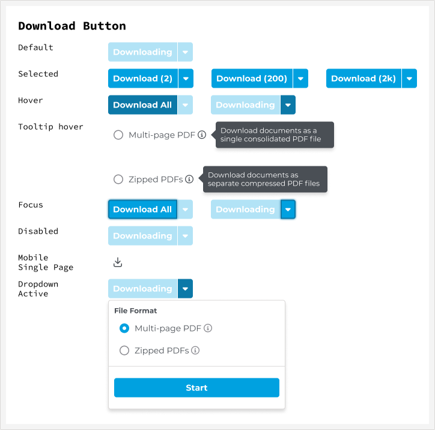
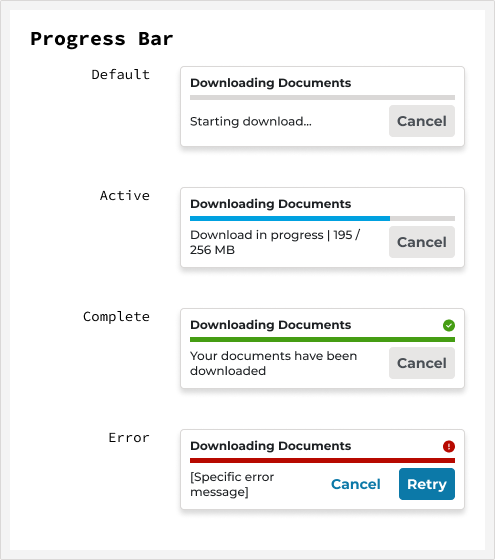
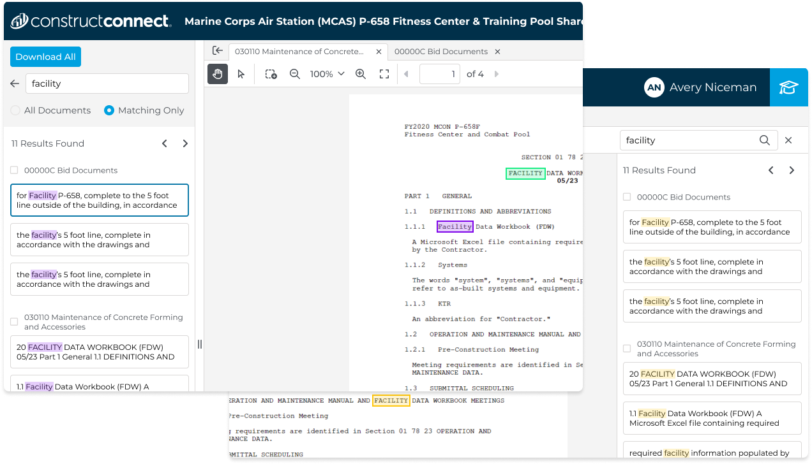

# Document Viewer: trimmed to the slide budget

Draft only. **Not applied to the page**; `lib/case-studies/document-viewer.tsx`
is unchanged. The budget is 180 words of text per slide: subheads,
paragraphs and quotes count. Images and their captions are outside the
budget, as are the slide title and metric figures. (The page's own
over-length marker in `CaseSlide` still counts captions, so its numbers
for Research will read higher than this draft's.)

**Cuts only, no rewrites.** Every kept passage, captions included, is your
original sentence with words removed, verified word by word against the
live page. The only other edits are punctuation and capitalization where a
cut starts or ends a sentence. Each slide's "What was cut" list shows the
removed text in ~~strikethrough~~, in place, so anything can be restored.

| Slide | Before | After | |
|---|---|---|---|
| 01 Overview | 149 | 149 | within budget |
| 02 Problem | 194 | 178 | within budget |
| 03 Research & solutions | 526 | 172 | within budget |
| 04 Results | 111 | 111 | within budget |
| 05 Impact | 103 | 103 | within budget |

"Before" is recounted on the same text-only basis, so the columns compare
like for like.

**Images (Research slide).** The purple highlight is the main image, with
its full original caption: captions no longer count, so the earlier trim
was undone. The download-button spec and progress bar return as a two-up
row with one-line captions, each cut from its original. The
matching-toggle image stays cut.

---

## 01 / 05 · Overview
*149 / 180 words, unchanged.*

Not squad-assigned during this project. UX and UI both worked as floaters across multiple concurrent projects and apps. I paired with a UX design partner who led discovery and journey mapping, while I owned interaction and visual design across the download and search experiences through multiple rounds of user testing.

All three phases released: View & Download, Search Within Viewer, then sharing and takeoff integration. It reached Project Intelligence Pro users in November 2024 with every target metric hit, and stayed in daily use until July 2025, when it was rolled back at full exposure for reasons that had nothing to do with the design. More on that in the outcome.

### My Role

Paired with a UX design partner who led discovery interviews and journey mapping. I owned interaction and visual design end to end across the search and download experiences, running multiple rounds of user testing on both.

---

## 02 / 05 · Problem
*178 / 180 words, trimmed from 194.*

Customers wanted to qualify projects faster. The existing document viewer worked against that goal: large documents sometimes took minutes to load, scrolling and zooming were clunky, there was no multi-page PDF export, and the document tree only went two digits deep on CSI codes, forcing users to download an entire division to find one spec.

Users had built workarounds instead of reporting the problem as broken. Some downloaded from Project Intelligence and re-uploaded into Bluebeam just to annotate. Others downloaded to a phone, then uploaded to SharePoint, because the desktop viewer was too unreliable to trust. In VOC interviews, multiple users independently described the experience as chaotic and unorganized.

The trigger to rebuild was infrastructure: a move to Elastic Search exposed use cases, like NOT/NEAR/AND keyword operators, the old viewer couldn’t support.

> The document viewer wasn’t a standalone feature. It was the connecting app between the qualification workflow and the estimation workflow, and the surface Building Product Manufacturer accounts would need before they could migrate off the legacy platform. Fixing it had leverage across two initiatives, not one.

What was cut from this slide (3)

- **Trimmed (p):** Customers wanted to qualify projects faster. The existing document viewer worked against that goal ~~at nearly every step:~~ large documents sometimes took minutes to load, scrolling and zooming were clunky, there was no multi-page PDF export, and the document tree only went two digits deep on CSI codes, forcing users to download an entire division to find one spec.
- **Trimmed (p):** The trigger to rebuild was infrastructure: a move to Elastic Search exposed use cases, like NOT/NEAR/AND keyword operators, the old viewer couldn’t support. ~~But the opportunity was bigger than a technical migration.~~
- **Trimmed (blockquote):** The document viewer wasn’t a standalone feature. It was the connecting app between the qualification workflow and the estimation workflow, and the surface Building Product Manufacturer accounts would need before they could migrate off the legacy platform ~~onto Project Intelligence.~~ Fixing it had leverage across two initiatives, not one.

---

## 03 / 05 · Research & solutions
*172 / 180 words, trimmed from 526.*

### Discovery & Research

Journey mapping placed the viewer at the seam between qualification and estimation. That reframed the work from “make the viewer faster” to “stop breaking the handoff between two workflows.”

### Process

Design went through four rounds of search-design iteration and two rounds on the download experience, each round tested before the next began.

*Two-up row:*

|  |  |
|:---|:---|
| *The download button, specified across every condition.* | *Progress needed its own states.* |

### Key Design Decisions

#### Tab layout won testing, but didn’t ship

Three layout directions were tested, including a tab layout, which won. It wasn’t implemented; the shipped version was a single-document view, cut before ship due to technical feasibility constraints.

#### Purple over yellow: an accessibility fix nobody asked for

Users had complained about the previous document viewer’s yellow-on-white keyword highlighting for a long time.

Several web-accessible color combinations were tested with users who had typical color vision as well as users with color vision deficiencies. Purple won.

*Caption:* The shipped purple highlight, tested against several web-accessible combinations with both typical and color-deficient vision. Matches stay legible in the results list and inside the document itself.

### The Solution

The rebuilt viewer opens large construction document sets in under three seconds, searches inside them with real keyword operators, and exports any combination of pages without leaving the app.

What was cut from this slide (13)

- **Cut (p, 36 words):** ~~My UX partner led VOC interviews and journey mapping; I sat in on sessions and worked from the output. The most useful finding wasn’t anything users said directly. It was what they’d built around the problem.~~
- **Cut (p, 43 words):** ~~Nobody had filed the viewer as broken. That mattered more than any single complaint. Workarounds as elaborate as the ones above tell you what the problem actually costs, because you can measure it in what people are willing to do to avoid it.~~
- **Trimmed (p):** Journey mapping placed the viewer at the seam between qualification and estimation, ~~the point where a user decides whether a project is worth pursuing.~~ That reframed the work from “make the viewer faster” to “stop breaking the handoff between two workflows.”
- **Trimmed (p):** Design went through four rounds of search-design iteration and two rounds on the download experience, each round tested before the next began ~~rather than batched into a single validation at the end.~~
- **Cut (p, 96 words):** ~~The two tracks needed different things. Search was a comprehension problem. Could users tell which documents matched, and why? Each round tested whether people could read the result set correctly. Download was the opposite kind of work. Once export moved beyond one file at a time, the button had to account for every condition it could be in: default, hover, focus, disabled, dropdown open, multiple documents selected, and the combinations of those. Specifying all of it is less exploratory than search design, and it is exactly the detail that decides whether the build matches the spec.~~
- **Trimmed (caption, dv-download-spec.png):** The download button, specified across every condition ~~it can be in. The counts matter: a user selecting 2 documents and a user selecting 2,000 need the same control to behave sensibly.~~
- **Trimmed (caption, dv-progress.png):** ~~Large document sets take real time to download, so~~ progress needed its own states. ~~The error state carries a retry rather than dead-ending the user.~~
- **Trimmed (p):** Three layout directions were tested, including a tab layout, which won. It wasn’t implemented; the shipped version was a single-document view, cut before ship due to technical feasibility constraints ~~given the build timeline. Everything else validated in testing shipped intact.~~
- **Trimmed (p):** ~~Testing early let the team nail down the overall design as well as the keyword-highlight accessibility problem before shipping something that would draw complaints, or worse, go unused.~~ Users had complained about the previous document viewer’s yellow-on-white keyword highlighting for a long time. ~~It’s incredibly hard to see for people without any visual disabilities, let alone people with them.~~
- **Trimmed (p):** Several web-accessible color combinations were tested with users who had typical color vision as well as users with color vision deficiencies. Purple won. ~~The reaction, internally and externally, exceeded expectations for what looked like a minor detail from the outside.~~
- **Trimmed (p):** The rebuilt viewer opens large construction document sets in under three seconds, searches inside them with real keyword operators, and exports any combination of pages without leaving the app. ~~Search results can be filtered to matching documents only, with per-document match counts, so a user scanning a hundred-file project sees where the answer is instead of hunting for it.~~
- **Cut (p, 55 words):** ~~The parts users noticed most weren’t the big ones. Purple highlighting instead of yellow. A document tree that goes deep enough to reach a single spec instead of an entire CSI division. Multi-page export where there had been none. Individually minor, collectively the difference between a tool people worked around and one they worked in.~~
- **Cut (image dv-matching-toggle.png + caption):** ~~Search within the viewer, toggling between all documents and matching-only results, with per-document match counts.~~

---

## 04 / 05 · Results
*111 / 180 words, unchanged.*

Released to Project Intelligence Pro users in November 2024. All three target metrics were hit.

**Metrics (not counted):** 25% Smaller downloads | 10%+ Faster performance | <3s Time to first document view

Then, in July 2025, after eight months at full exposure, the viewer was rolled back, not for anything in the design, but for networking and security failures in the underlying infrastructure.

> Shipping isn’t the finish line, and hitting your metrics doesn’t make the work permanent. A design can be validated, adopted, and still get pulled by a layer you don’t own.

I’m including it anyway. The eight months it was live are real, the metrics held, and the accessibility work in particular outlived the rollback. Portfolios that only show work still standing aren’t showing the job.

---

## 05 / 05 · Impact
*103 / 180 words, unchanged.*

### Reflection

**What worked:** Early testing caught the highlight-color problem before ship, avoiding a repeat of years of user complaints about the old viewer.

**What I’d do differently:** Push harder for research-validated features to ship as designed, like the tab layout, or secure a committed fast-follow rather than an open-ended “later” that risks never happening.

**What this unlocked:** A credible surface for Building Product Manufacturer accounts, the foundation for the Ask Documents AI panel, and the migration effort off the legacy platform. Ask Documents later became the internal proof that conversational AI worked for this user base, the argument that made Search Assist fundable.

